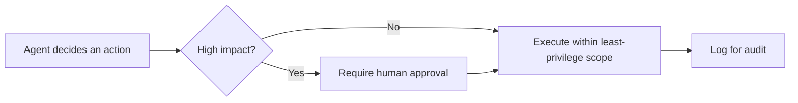

## Overview

An **AI agent** plans and acts in loops, calling tools to achieve a goal. Autonomy is the value —
and the risk. OWASP calls the core failure mode **Excessive Agency**: too much permission,
functionality, or autonomy.

## The three dimensions of excessive agency

- **Excessive permissions** — the agent's credentials can do more than the task needs.
- **Excessive functionality** — tools expose more capability than required.
- **Excessive autonomy** — the agent acts without approval on high-impact actions.

## Defenses

- **Least privilege** for the agent's identity and every tool.
- **Human-in-the-loop** gates for irreversible or outward-facing actions.
- **Bound the loop** — limits on steps, spend, and time (guards against
  unbounded consumption).
- **Full audit logging** of decisions and actions.

Related: [MCP Security](/ai-security/mcp-security) and
[Prompt Injection](/ai-security/prompt-injection).

## References

See the primary source below.
