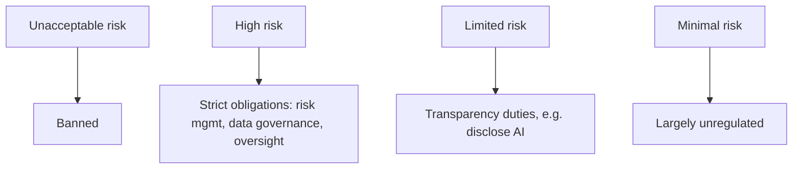

## Overview

The **EU AI Act** is the EU's regulation of artificial intelligence. It takes a **risk-based**
approach: obligations scale with the risk a system poses.

## The risk tiers

- **Unacceptable risk** — prohibited practices (e.g. social scoring).
- **High risk** — conformity assessment, risk management, human oversight, logging.
- **Limited risk** — transparency (tell users they're interacting with AI).
- **Minimal risk** — most AI; no specific obligations.

## Why it matters

Like GDPR, it applies extraterritorially and carries significant penalties. It intersects with
[GDPR](/frameworks/gdpr) wherever AI processes personal data.

## References

Educational summary only — not legal advice. See the primary source below.
