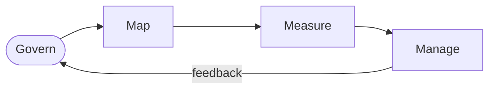

## Overview

The **NIST AI Risk Management Framework (AI RMF 1.0)** is a voluntary framework to help
organizations manage the risks of AI systems and build **trustworthy AI** — addressing not only
security but fairness, transparency, safety, and accountability.

## The four functions

- **Govern** — cultivate a culture of risk management (cross-cutting).
- **Map** — establish context and identify risks.
- **Measure** — analyze and track risks with metrics.
- **Manage** — prioritize and act on risks.

## Why it matters

It complements security-only frameworks by framing **AI-specific** risk. Use it alongside
[MITRE ATLAS](/ai-security/mitre-atlas) (threats) and
[ISO/IEC 42001](/ai-security/iso-42001) (management system) for a complete governance picture.

## References

See the primary source below.
