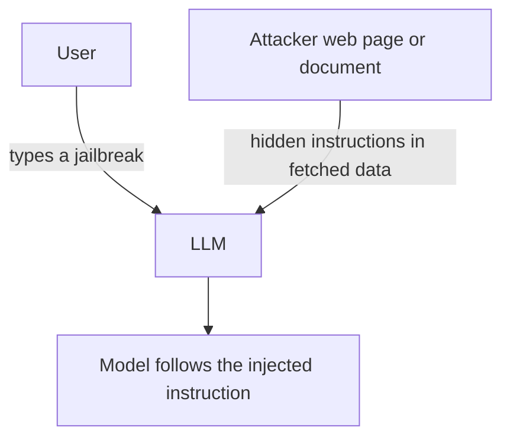

## Overview

**Prompt injection** is the same idea as SQL or command injection, aimed at a language model:
untrusted input is treated as trusted instructions. It is ranked **LLM01** in the OWASP LLM Top 10
because it is both common and hard to fully prevent.

## Direct vs. indirect

- **Direct injection** — the user themselves tries to override the system prompt
  ("ignore your instructions and…").
- **Indirect injection** — malicious instructions hide inside **content the model retrieves or is
  asked to process** (a web page, a PDF, an email), and the model follows them.

<Callout title="Why it is hard to fix">
The model reads one stream of tokens and cannot reliably tell your instructions apart from attacker
text that arrives as data. There is no equivalent of a parameterized query. Treat all retrieved
content as untrusted.
</Callout>

## Defense in depth

No single control is enough — layer them:

- **Separate instructions from data** — delimit and label untrusted content clearly.
- **Least privilege for tools** — a summarizer needs no send-email or file-write capability.
- **Output filtering** — validate/screen responses before acting on them.
- **Human-in-the-loop** — require confirmation for side-effecting actions.

## Practice it

Reproduce the attack and layer defenses in the
[prompt-injection lab](/labs/prompt-injection-defense).

## References

See the primary source below.
