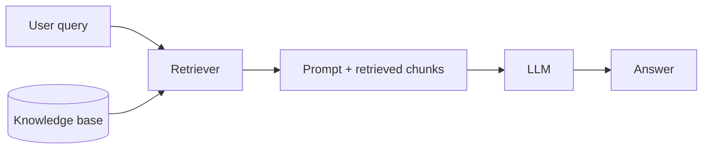

## Overview

**Retrieval-Augmented Generation (RAG)** grounds an LLM's answers in retrieved documents. That
retrieval step is a new attack surface: whatever is retrieved becomes part of the prompt.

## Where it goes wrong

- **Indirect prompt injection** — poisoned documents in the knowledge base carry hidden
  instructions the model then follows.
- **Data poisoning** — attacker-controlled content is ingested into the index.
- **Access-control bypass** — retrieval returns documents the user should not see (broken
  tenant/permission isolation).
- **Embedding weaknesses** — crafted inputs manipulate similarity search.

## Defenses

- **Trust boundary on retrieved content** — treat it as untrusted data, never instructions.
- **Enforce authorization at retrieval** — filter the index by the user's permissions.
- **Curate and validate ingested sources** — control what enters the knowledge base.
- **Isolate tenants** — separate indexes or strict metadata filtering.

See [Prompt Injection](/ai-security/prompt-injection) for the underlying mechanism.

## References

See the primary source below.
