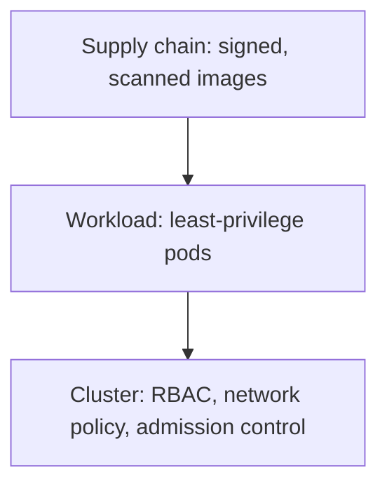

## Overview

Kubernetes security spans several layers — the cluster, the workloads, and the images that run in
them. Defaults are permissive, so hardening is on you.

## The layers

## Core practices

- **RBAC** — bind subjects to least-privilege Roles; avoid cluster-admin.
- **NetworkPolicy** — default-deny pod traffic, allow only what's needed.
- **Pod security** — drop root, read-only filesystems, no privileged containers.
- **Admission control** — enforce policy at deploy time (e.g. policy engines).
- **Image supply chain** — scan and sign images; pin digests.
- **Secrets** — use a real secrets manager, not plain Kubernetes Secrets alone.

## Maps to

Access, network, and logging controls map across frameworks — see the
[Control Explorer](/control-mapping) — and image signing ties to
[model/software supply chain](/ai-security/model-supply-chain).

## References

See the primary source below.
