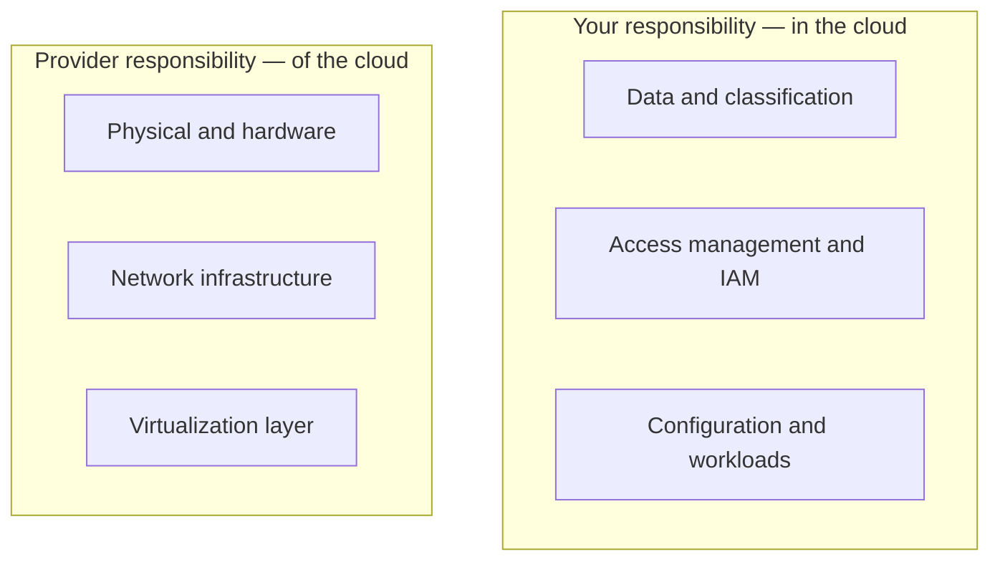

## Overview

In the cloud, security is **shared**: the provider secures the infrastructure (&ldquo;security *of*
the cloud&rdquo;) and you secure what you put in it (&ldquo;security *in* the cloud&rdquo;). Getting
this boundary right is the first step of every cloud-security program.

## Where the line sits

The split **shifts with the service model**:

| Model | You secure | Provider secures |
| --- | --- | --- |
| IaaS | OS, apps, data, IAM, network config | Hypervisor down |
| PaaS | Apps, data, IAM | Runtime and OS |
| SaaS | Data, access, usage | Almost everything else |

## The constant

No matter the model, **your data, your access control, and your configuration** are almost always
yours to secure. Most cloud breaches are misconfiguration — not a provider failure.

## References

See the primary source below and the [Control Explorer](/control-mapping).
