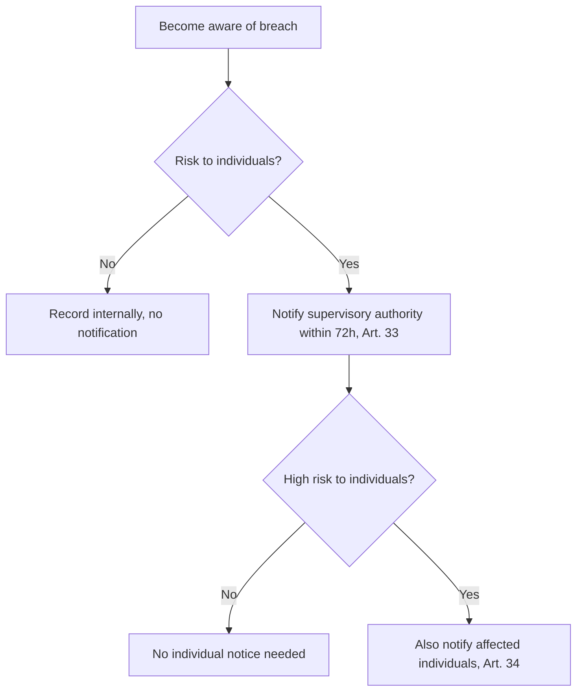

## Overview

The **General Data Protection Regulation (GDPR)** is the EU regulation governing the processing of
personal data of individuals in the EU/EEA. It applies extraterritorially to organizations outside
the EU that offer goods/services to, or monitor, people in the EU.

## Purpose

Protect the fundamental rights and freedoms of natural persons — in particular their right to the
protection of personal data — while enabling the free movement of that data within the EU.

## Architecture

GDPR is built on a set of **principles** (Article 5), **lawful bases** for processing (Article 6),
**data-subject rights** (Articles 12–23), and obligations for **controllers and processors**,
including security of processing (Article 32) and breach notification (Articles 33–34).

## Core Concepts

- **Personal data & special categories** — any information relating to an identified/identifiable
  person; sensitive categories get extra protection.
- **Controller vs. processor** — who determines purposes/means vs. who processes on their behalf.
- **Lawful basis** — consent, contract, legal obligation, vital interests, public task, or
  legitimate interests.
- **Data-subject rights** — access, rectification, erasure, portability, objection, and more.

Personal data rarely sits still. Mapping how it flows between the data subject, your systems
(controller), your vendors (processors), and independent third parties is the technique used to
build your Record of Processing Activities:

<DataFlowDiagram />

## Controls

The security obligations live in **Article 32 — Security of processing**.

<Official>
Taking into account the state of the art … the controller and the processor shall implement
appropriate technical and organisational measures to ensure a level of security appropriate to the
risk, including inter alia … the pseudonymisation and encryption of personal data (GDPR, Article 32).
Consult the official regulation text for the authoritative wording.
</Official>

## Breach notification (Articles 33–34)

When a personal-data breach happens, the decision to notify follows a simple path — and the clock
starts the moment you **become aware**, not when the breach occurred:

<BreachTimeline />

## Real-world Examples

- Encrypting personal data at rest and in transit to satisfy Article 32(1)(a).
- Restricting access to personal data via least-privilege IAM (Article 32(1)(b)).
- A 72-hour breach notification workflow to the supervisory authority (Article 33).

## Cloud Mapping

Article 32(1)(b) — "ongoing confidentiality … and controlled access" — maps to AWS IAM, Azure
RBAC + Entra ID, and Kubernetes RBAC. Encryption maps to KMS/Key Vault and envelope encryption.

## Implementation Guidance

1. Build a **record of processing activities (RoPA)**.
2. Establish a lawful basis for each processing activity.
3. Implement Article 32 technical/organizational measures proportionate to risk.
4. Stand up data-subject-request and breach-notification workflows.
5. Run **DPIAs** for high-risk processing.

## Interview Questions

- When is a Data Protection Impact Assessment (DPIA) required?
- What is the difference between a controller and a processor?

## Quiz

- What is the deadline for notifying a supervisory authority of a personal-data breach?

## References

Educational summary only — not legal advice. See the primary source below.
