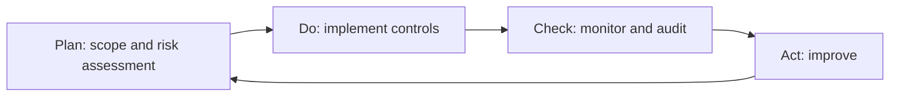

## Overview

ISO/IEC 27001 is the international standard for an **information security management system
(ISMS)**. It specifies requirements for establishing, implementing, maintaining, and continually
improving information security within the context of an organization, and it is the standard against
which organizations can be independently **certified**.

<Callout title="What we map">
The academy's focus is showing how the standard's controls map to concrete technical controls in
AWS, Azure, and Kubernetes — see [Control Mapping](/control-mapping) for a worked example.
</Callout>

## Purpose

Give organizations a risk-based, auditable system for managing the confidentiality, integrity, and
availability (CIA) of information — one that scales from a startup to a multinational and can be
certified by an accredited body.

## Architecture

The standard has two parts:

- **Management-system clauses (4–10)** — the normative requirements for the ISMS itself: context,
  leadership, planning, support, operation, performance evaluation, and improvement.
- **Annex A** — a reference catalogue of controls, revised in the 2022 edition to **93 controls**
  across four themes: organizational, people, physical, and technological.

The ISMS runs as a continuous **Plan-Do-Check-Act** loop:

## Core Concepts

- **ISMS scope & context** — what the system protects and the internal/external issues that shape it.
- **Risk assessment & treatment** — identify, analyze, evaluate, and treat information-security risk.
- **Statement of Applicability (SoA)** — the justified list of which Annex A controls apply.
- **Continual improvement** — the Plan-Do-Check-Act cycle drives ongoing maturation.

## Controls

Controls are **selected via risk treatment**, not adopted wholesale, and documented in the SoA.

<Official>
The organization shall define and apply an information security risk treatment process to select
appropriate risk treatment options and determine the controls necessary to implement them
(ISO/IEC 27001:2022, Clause 6.1.3). Always consult the official standard for normative text.
</Official>

The four Annex A themes:

| Theme          | Example controls                                  |
| -------------- | ------------------------------------------------- |
| Organizational | Policies, access control, supplier relationships  |
| People         | Screening, awareness, remote working              |
| Physical       | Secure areas, equipment, clear desk/screen        |
| Technological  | Cryptography, logging, secure development         |

## Cloud Mapping

Access control (A.5.15–A.5.18) maps directly to cloud IAM primitives:

| Provider   | Primitive                    |
| ---------- | ---------------------------- |
| AWS        | IAM policies, roles, SCPs    |
| Azure      | Azure RBAC + Entra ID        |
| Kubernetes | RBAC Roles / RoleBindings    |

See the full [Control Mapping](/control-mapping) page.

## Implementation Guidance

1. Define the ISMS scope and secure leadership commitment.
2. Perform a risk assessment; decide risk treatment.
3. Select Annex A controls and write the Statement of Applicability.
4. Operate, monitor, measure, and internally audit the ISMS.
5. Undertake certification (Stage 1 documentation review, then Stage 2 audit).

## Interview Questions

- What is the difference between ISO 27001 and ISO 27002?
- What is a Statement of Applicability, and why does it matter?
- How does risk treatment drive control selection?

## Quiz

- How many controls are in Annex A of the 2022 edition, and what are the four themes?

## References

See the primary sources listed below.
