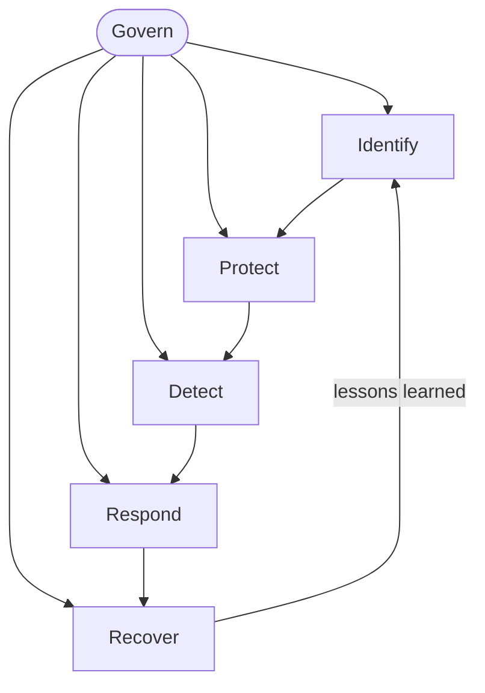

## Overview

The NIST Cybersecurity Framework (CSF) 2.0 is a **voluntary, outcome-based** framework for managing
cybersecurity risk. Version 2.0 (2024) broadened its audience beyond critical infrastructure to
organizations of all sizes and sectors, and added a sixth function: **Govern**.

## Purpose

Provide a common language for describing cybersecurity posture, setting targets, and communicating
risk to both technical teams and leadership — without prescribing specific technologies.

## Architecture

CSF is organized into a hierarchy of **Functions → Categories → Subcategories**. The six functions:

| Function | Outcome                                                        |
| -------- | ------------------------------------------------------------- |
| Govern   | Establish and monitor the cybersecurity risk-management strategy |
| Identify | Understand assets, risks, and the business context             |
| Protect  | Safeguard assets and limit the impact of events                |
| Detect   | Find and analyze possible attacks and compromises              |
| Respond  | Take action on a detected incident                             |
| Recover  | Restore capabilities and services impaired by an incident      |

**Govern** sits at the centre in CSF 2.0 — it informs and is informed by the other five functions:

## Core Concepts

- **CSF Core** — the taxonomy of outcomes (Functions/Categories/Subcategories).
- **Organizational Profiles** — current vs. target state, used to prioritize gaps.
- **Tiers** — a characterization of how rigorous and adaptive the risk practices are.

## Controls

CSF describes **outcomes**, not controls. Map its Subcategories to control catalogs such as
NIST SP 800-53, ISO 27001 Annex A, or CIS Controls to operationalize them.

## Cloud Mapping

The **Protect (PR.AA)** identity and access-control outcomes map to AWS IAM, Azure RBAC + Entra ID,
and Kubernetes RBAC; **Detect (DE.CM)** continuous monitoring maps to CloudTrail/GuardDuty, Azure
Monitor/Defender, and audit logging.

## Incident response lifecycle

The **Detect → Respond → Recover** functions map onto the classic NIST incident-response lifecycle,
a loop whose post-incident lessons feed back into preparation:

## Implementation Guidance

1. Create a **current profile** of existing outcomes.
2. Define a **target profile** aligned to business risk.
3. Prioritize the gap and build an action plan.
4. Repeat as risk and the organization evolve.

## Interview Questions

- What changed between CSF 1.1 and 2.0? (Hint: the Govern function.)
- How do CSF Profiles and Tiers differ?

## Quiz

- Name the six CSF 2.0 functions in order.

## References

See the primary sources listed below.
