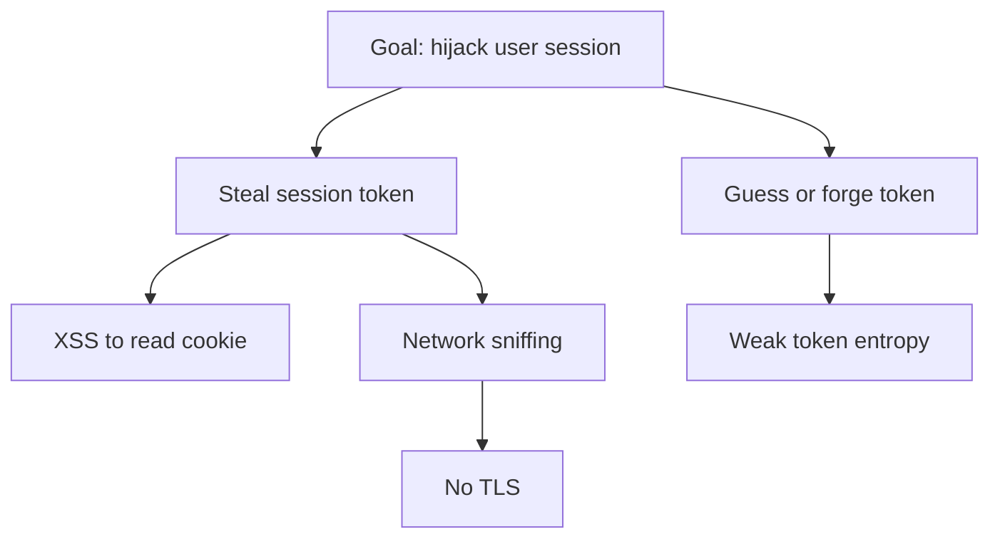

## Overview

An **attack tree** is goal-first: put the attacker's objective at the root, then branch into the
ways to reach it. It complements [STRIDE](/threat-modeling/stride) — STRIDE finds threats per
element; attack trees reason about a whole goal.

## Example: steal a user's session

## How to use it

- Read leaves as the concrete attacks to defend against.
- Optionally annotate nodes with cost, skill, or likelihood to prioritize.
- Each leaf should map to a mitigation and a control
  (see the [Control Explorer](/control-mapping)).

## References

See the primary source below.
