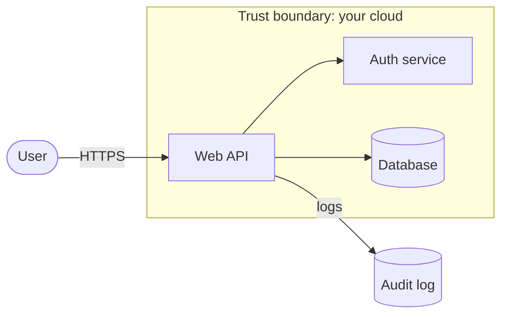

## Overview

A **data-flow diagram (DFD)** answers the first threat-modeling question — *what are we building?* —
by showing processes, data stores, data flows, and external entities, with **trust boundaries**
drawn where control changes hands.

## A simple DFD

## The four element types

- **External entity** — a user or system outside your control (rectangle/rounded).
- **Process** — code that transforms data.
- **Data store** — where data rests (cylinder).
- **Data flow** — data moving between elements (arrow).

## Why boundaries matter

Threats concentrate where data **crosses a trust boundary** — every crossing is where you apply
[STRIDE](/threat-modeling/stride). See [trust boundaries](/threat-modeling/trust-boundaries).

## References

See the primary source below.
