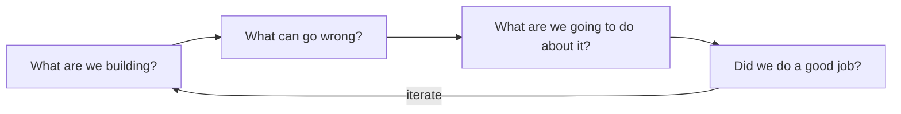

## Overview

Threat modeling is a structured way to find design weaknesses **before** you ship. At its core it is
four questions, popularized by Adam Shostack:

## The four questions

1. **What are we building?** — model the system, usually a
   [data-flow diagram](/threat-modeling/data-flow-diagrams) with
   [trust boundaries](/threat-modeling/trust-boundaries).
2. **What can go wrong?** — enumerate threats, e.g. with
   [STRIDE](/threat-modeling/stride) or an [attack tree](/threat-modeling/attack-trees).
3. **What are we going to do about it?** — choose mitigations, each mapped to a concrete control.
4. **Did we do a good job?** — validate coverage and iterate.

## When to do it

During **design**, and again on significant change. A flaw caught in design is a conversation; the
same flaw in production is an incident.

## References

See the primary source below.
