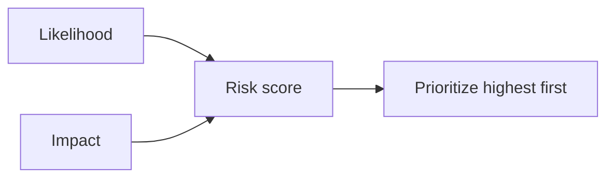

## Overview

Enumeration finds threats; **rating** decides order. You can't fix everything at once, so rank by
risk = **likelihood × impact**.

## The simple model

Estimate likelihood (how easy/probable the attack is) and impact (what happens if it succeeds),
combine, and treat the highest-risk items first.

## Named approaches

- **OWASP Risk Rating** — factors for likelihood (skill, opportunity) and impact (technical,
  business), producing a defensible score.
- **DREAD** — Damage, Reproducibility, Exploitability, Affected users, Discoverability. Simple but
  subjective; use with care.

## The point

Rating is about **triage**, not precision. A rough, consistent ranking that drives action beats a
perfect score that doesn't. Feed the result back into the
[process](/threat-modeling/process) — decide mitigations for the top risks.

## References

See the primary source below.
